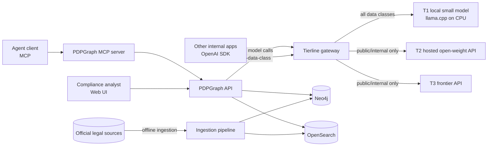
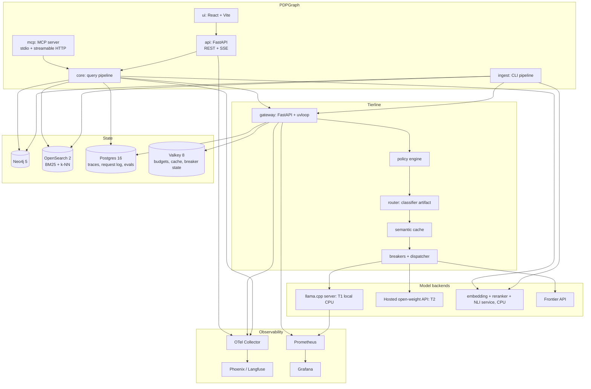
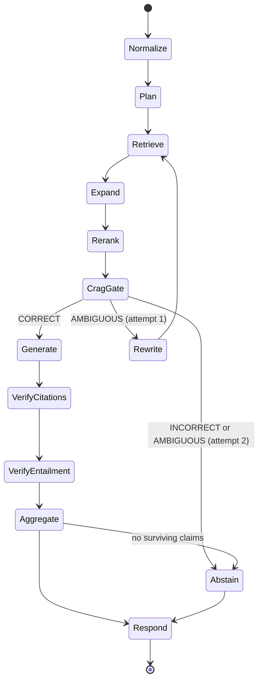
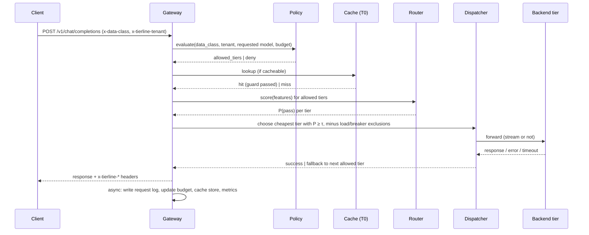

# 03 — System Architecture

| Field | Value |
|---|---|
| Version | 1.1 |
| Date | 2026-11-05 |
| Traces to | 01-BRD, 02-PRD; decisions in 10-adr |

---

## 1. Architectural principles

1. **Deterministic spine, probabilistic leaves.** Parsing, ID assignment, graph traversal, citation checks, policy, budgets, and circuit breaking are plain code. LLMs are used only where judgment is required (decomposition, extraction, CRAG ambiguity, generation, applicability), and every LLM output is schema-validated.
2. **Verify, then show.** Nothing reaches the user unless it survived deterministic and entailment verification.
3. **Abstain over guess.** Every stage can short-circuit to `INSUFFICIENT_EVIDENCE`.
4. **Policy in the gateway, not in callers.** Data-class enforcement lives in Tierline, deny-by-default.
5. **Everything is traced; everything is replayable.** Every request produces an OTel trace and a persisted decision trace. Eval runs replay recorded inputs against new configs.
6. **Measure before optimizing.** No routing/caching/prompt change merges without an eval delta.

## 2. System context



## 3. Container view



Note: embedding, reranking, and NLI run as a separate local service (`models-aux`), **not** through Tierline routing — they are fixed models, not routed generation. They are always local.

## 4. Technology stack

| Concern | Choice | Rationale (see ADRs) |
|---|---|---|
| Language | Python 3.12 (backend), TypeScript (UI) | ADR-002 |
| Package mgmt | `uv` workspace (monorepo) | Fast, lockfile, workspaces |
| Web framework | FastAPI + uvicorn (uvloop), Pydantic v2 | Typed schemas shared across REST/MCP |
| HTTP client | `httpx` async with connection pooling | Streaming support |
| Graph DB | Neo4j 5 Community | ADR-003 |
| Search | OpenSearch 2.x (Indonesian analyzer + k-NN, hybrid) | ADR-004 |
| Relational | Postgres 16 | Traces, request log, eval results, review queue |
| Cache / counters | Valkey 8 (BSD-licensed, Redis-protocol compatible); "Redis" in these docs means this service | Budgets, semantic cache entries, breaker state (ADR-014) |
| Local LLM serving | llama.cpp server on CPU (OpenAI-compatible, JSON-schema/grammar-constrained output, metrics endpoint); the same adapter family supports vLLM for optional, time-boxed cloud-notebook benchmark sessions | ADR-013 (supersedes ADR-005) |
| Edge tier (optional) | llama.cpp server (ROCm/CPU) | Laptop development |
| Embeddings | bge-m3 class multilingual model on CPU (ONNX/int8 where possible) [VERIFY best current option] | Corpus is small (one law ≈ hundreds of units), so CPU indexing is fine; queries embed one string |
| Reranker | bge-reranker-v2-m3 class cross-encoder on CPU; cap candidates (≤ 30 per sub-question) | Multilingual rerank; CPU latency is the main cost — measured per stage |
| NLI | multilingual NLI cross-encoder (mDeBERTa-xnli class) | Claim entailment |
| LLM tiers | T1: small instruct model ~1.5–4B, GGUF Q4/Q5, CPU. T2: hosted open-weight ~7–32B class via an OpenAI-compatible provider. T3: frontier API. Choose latest suitable models/providers at build time [VERIFY availability, prices, data-retention terms] | Indonesian ability, JSON reliability, cost |
| Router model | scikit-learn logistic regression / small MLP over features; ONNX export optional | ADR-007 |
| MCP | Official MCP Python SDK | Protocol conformance |
| Tracing | OpenTelemetry SDK → OTel Collector → Phoenix (dev) / Langfuse (optional) | ADR-008 |
| Metrics | Prometheus client + Grafana | Standard |
| Load testing | Locust (trace replay) | Python, scriptable |
| Eval | Custom harness + Ragas/DeepEval metrics where appropriate | ADR-009 |
| UI | React + Vite + TypeScript, Cytoscape.js for trace graph | Lightweight |
| Deployment | Docker Compose with profiles (`core`, `local-llm`, `obs`), CPU-only, memory-limited | BR-16 |
| CI | GitHub Actions | Lint, type-check, tests, replay evals |

## 5. Component design — PDPGraph

### 5.1 Ingestion pipeline (offline, `pdpgraph ingest`)

Stages are idempotent; each writes an artifact under `data/processed/<source_id>/<stage>.jsonl` so stages can be rerun independently.

| Stage | Input → Output | Deterministic? |
|---|---|---|
| `fetch` | Source URL/file → raw file + SHA-256 + provenance record | Yes |
| `extract` | PDF/HTML → ordered text lines with page/position | Yes (pdfplumber / PyMuPDF; OCR fallback flagged) |
| `segment` | Lines → hierarchy tree (Bab/Bagian/Paragraf/Pasal/Ayat/huruf) using a grammar-based state machine over line patterns (e.g., `^BAB [IVXLC]+`, `^Pasal \d+`, `^\(\d+\)`, `^[a-z]\.`) | Yes |
| `penjelasan` | Penjelasan section → mapped to Pasal/ayat by header ("Pasal 20 Ayat (2) ...", "Cukup jelas") | Yes |
| `ids` | Tree → stable node IDs (04-data-model §2) | Yes |
| `refs` | Text → reference mentions via regex grammar (Pasal X, ayat (Y), huruf z, "Undang-Undang ini", external laws) → resolved targets | Yes; unresolved logged |
| `defs` | Definitional articles → `Definition` nodes; term matcher links usages (normalized, morphology-light matching) | Yes |
| `obligations` | Paragraph text → `Obligation` candidates via LLM (Tierline, data class `public`, guided JSON) → validation → review queue | LLM + schema |
| `load_graph` | All artifacts → Neo4j (MERGE on IDs; transactional) | Yes |
| `index` | Paragraph units → OpenSearch docs (text, Penjelasan, ancestors, validity, embedding) | Yes |
| `snapshot` | Golden snapshot tests: node counts, specific article texts, reference counts | Yes |

Manual corrections live in `data/overrides/<source_id>.yaml` (e.g., fix a mis-segmented ayat) and are applied after `segment` — never by editing generated artifacts.

### 5.2 Query pipeline (online)

Implemented as an explicit state machine (`core/pipeline/`), not a framework graph. Each state is a pure-ish async function `(ctx) -> ctx`, with a transition table; the whole context is persisted to the decision trace at the end (and on failure).



| State | Behavior |
|---|---|
| **Normalize** | Detect language; normalize whitespace/diacritics; extract explicit references in the question ("Pasal 20") as hard retrieval hints; resolve `as_of` (default: today). |
| **Plan** | Plan-and-Solve decomposition via T1/T2 (guided JSON): 1–4 sub-questions, each tagged with an intent (`definition`, `obligation`, `exception`, `sanction`, `procedure`, `scope`). Single-intent questions skip decomposition (heuristic + router). |
| **Retrieve** | Per sub-question: BM25 top-k₁ and dense top-k₂ from OpenSearch filtered by `valid_from ≤ as_of < valid_to`; reciprocal-rank fusion (k=60). Explicit reference hints are force-included. |
| **Expand** | Graph expansion in Neo4j: for each retrieved paragraph, follow `REFERENCES` (≤ 2 hops), `USES_TERM → Definition`, parent Pasal, sibling ayat when the paragraph says "sebagaimana dimaksud pada ayat (1)", and `Penjelasan`. Each expanded node carries its path and hop count. Budget: max N expanded nodes, prioritized by hop count then fused score. |
| **Rerank** | Cross-encoder over (sub-question, node text) for direct + expanded nodes; keep top-m per sub-question; record scores. |
| **CragGate** | Per sub-question evidence sufficiency: rerank-score thresholds give `CORRECT` (≥ hi), `INCORRECT` (< lo), otherwise `AMBIGUOUS`, and the ambiguous band is adjudicated by an LLM evaluator (guided JSON: sufficient / partial / insufficient + missing aspect). Thresholds are calibrated on the dev set (06-eval). Overall: all sub-questions `CORRECT` → generate; any `INCORRECT` on a required sub-question → abstain (or partial answer with that sub-question marked missing); `AMBIGUOUS` → one rewrite attempt. |
| **Rewrite** | Query rewrite using missing-aspect hint + legal synonyms dictionary; increase graph hop budget by 1. Max 1 iteration (bounded). |
| **Generate** | LLM (tier chosen by Tierline; data class `internal`, because the prompt contains user question text — ADR-015) with guided JSON decoding into `GeneratedAnswer` schema. Evidence is provided as numbered blocks with `node_id` and text; the model may only cite provided `node_id`s and must give spans as quoted substrings. |
| **VerifyCitations** | Deterministic: for each citation — node in evidence set, node valid at `as_of`, quoted text is a substring of node text (after normalization) → compute character span. Claims with zero valid citations are dropped. |
| **VerifyEntailment** | NLI(premise = concatenated cited spans + parent context, hypothesis = claim). `entailment ≥ θ_e` → supported; `contradiction ≥ θ_c` → dropped and flagged; else → optional LLM verifier (routed via Tierline under the request's data class) decides; unresolved → dropped. |
| **Aggregate** | Recompute verdict from surviving claims using rules (e.g., any obligation claim with a satisfied condition → `OBLIGATION_APPLIES`). Generated verdict is advisory; rule-based recomputation wins on conflict and the conflict is logged. |
| **Abstain** | Build `INSUFFICIENT_EVIDENCE` response with `missing_evidence` from CRAG/verification outputs. |
| **Respond** | Attach disclaimer, trace ID, timing; persist decision trace (Postgres JSONB); end OTel span. |

### 5.3 Gap analysis

1. Validate input `ProcessingActivity` (04-data-model §4).
2. **Candidate obligations via graph** (deterministic Cypher): obligations whose `actor` matches the role (controller/processor), filtered by triggers (e.g., `data_categories` includes a specific category → obligations linked to that `DataCategory`; `cross_border: true` → transfer obligations; `large_scale` → DPO obligations).
3. **Applicability + status per obligation** via LLM (data class `confidential` → local tiers only), guided JSON: `status`, `rationale`, `facts_used`, `facts_missing`, citations restricted to the obligation's source paragraphs + expansions.
4. Same citation + entailment verification as Q&A.
5. Map-reduce: obligations are evaluated in parallel (bounded concurrency), then reduced into a report with summary counts.

### 5.4 MCP server

- Thin adapter over `core` (no business logic). Transports: stdio (local agent clients) and streamable HTTP.
- Tools: `pdp.query`, `pdp.gap_analysis`, `pdp.get_article`, `pdp.explain`. Resources: `pdp://article/{node_id}`.
- Tool descriptions are versioned in code; output schemas = REST schemas.

## 6. Component design — Tierline

### 6.1 Request lifecycle



### 6.2 Policy engine

- Pure function: `evaluate(request_ctx, config, budget_state) -> PolicyDecision(allowed_tiers, reasons, deny_code?)`.
- Data-class matrix (default; config-overridable only to be *more* restrictive):

| Data class | T0 cache | T1 local (CPU) | T2 hosted open-weight (external) | T3 frontier (external) |
|---|---|---|---|---|
| `public` | ✅ (tenant-scoped) | ✅ | ✅ | ✅ |
| `internal` | ✅ (tenant-scoped) | ✅ | ✅ if tenant opts in | ✅ if tenant opts in |
| `confidential` | ✅ (tenant-scoped) | ✅ | ❌ | ❌ |
| `pii` | ❌ | ✅ | ❌ | ❌ |

The rule is defined on `locality`, not on tier names: `confidential`/`pii` may only reach tiers with `locality: local`. Adding a new external tier can never widen access.

- Missing `x-data-class` → `internal`. Unknown value → deny `400 invalid_data_class`.
- **PII scanner (escalation only):** before policy, a deterministic scanner checks message content for Indonesian PII patterns (16-digit NIK, +62/08 phone numbers, emails, NPWP-like numbers, card-like numbers with Luhn check) [TUNE]. A hit **raises** the effective data class to `pii` (never lowers it), is recorded in the explain record as `escalated_from`, and is counted in `tierline_pii_escalations_total`. The scanner never logs the matched text (FR-GW-17, SEC-16).
- Budget exhausted → `reject` (429) or `downgrade` (remove paid external tiers; T1 only).
- Requested concrete model → allowed only if its tier is in `allowed_tiers`, else `403 policy_model_forbidden`.
- Property-based tests (Hypothesis) assert: no `confidential`/`pii` request ever yields an external tier (T2 or T3) in any decision or fallback chain.

### 6.3 Semantic cache (T0)

- Eligible: temperature == 0 (or `cache: true` extension field), no tools, data class ≠ `pii`.
- Key space: `(tenant, model_class, system_prompt_hash)`; vector = embedding of the last user message (+ hash of prior turns).
- Hit requires: cosine ≥ 0.95 [TUNE] **and** entity/number guard: the multiset of numbers, dates, article references (`Pasal \d+`), and named entities (simple NER / regex for MVP) must match exactly **and** TTL not expired.
- Storage: Redis (vector search via RediSearch if available, else a small in-process HNSW index with Redis as persistence) [decide in ADR-006].
- Metrics: hit rate, guard-rejection rate, and **false-hit rate** measured offline (06-eval).

### 6.4 Router

- Features: prompt embedding (small multilingual embedding, reduced dim), token length, number of turns, language, presence of code/JSON schema request, `response_format` type, task tag from caller (optional `x-tierline-task` header), PDPGraph stage name.
- Model: one binary classifier per tier, `P(output quality ≥ q | features, tier)`. Labels from eval runs where every prompt was answered by every tier and judged (06-eval §5).
- Decision: among allowed, healthy tiers ordered by expected cost, pick the first with `P ≥ τ`; if none, pick the tier with the highest P (usually the largest allowed).
- `τ` per tenant (default 0.8) and per request (`x-tierline-quality` header) — this knob generates the Pareto curve.
- Artifact: versioned file `router/<version>/model.joblib` + `metadata.json` (feature spec, training data hash, eval metrics); hot-reloaded on SIGHUP or file change.
- Fallback when no router artifact: static rule table (task tag → tier).

### 6.5 Dispatcher, load awareness, resilience

- Backend adapters: `vllm`, `llamacpp`, `openai_compatible`, `frontier`. All speak OpenAI-compatible HTTP; adapter handles quirks and token accounting.
- Load signal, local tier: scrape llama.cpp `/metrics` + `/slots` every 1 s [TUNE][VERIFY endpoints] (busy slots, queued requests, tokens/s). On CPU, T1 has very few parallel slots, so saturation happens early — this is where load-aware spill-over matters most.
- Load signal, external tiers: in-flight count, TTFT EWMA, provider rate-limit headers and recent 429s.
- Effective score = `cost + λ·expected_latency(load)`; a tier is skipped when all slots are busy and its queue > W, or when it is rate-limited. For `confidential`/`pii`, saturation of T1 means **queue or fail**, never spill to an external tier.
- Circuit breaker per tier: open after F consecutive failures or timeout rate > X% over window; open duration with exponential backoff; half-open allows 1 probe.
- Timeouts: connect, time-to-first-token (TTFT), total; streaming requests fail over only before the first token is sent to the client (mid-stream failover is [STRETCH]: replay with partial output as assistant prefix).
- Retries: non-streaming only, max 1 per tier, jittered.
- Hedging [STRETCH]: for `x-tierline-priority: high`, launch next tier if TTFT > p95 of current tier.

### 6.6 Accounting

- Token counts from backend `usage` (streaming: `stream_options.include_usage` when supported; else tokenizer estimate flagged `estimated: true`).
- Cost = tokens × tier price. External tiers use the provider's published price (recorded with date). The local CPU tier is priced by amortized machine cost per token from config (ADR-012), so Pareto curves don't treat local as free.

## 7. Deployment topology

Docker Compose, profiles:

| Profile | Services |
|---|---|
| `core` | neo4j, opensearch, postgres, valkey — **stores only** |
| `app` | pdpgraph-api, pdpgraph-mcp, tierline, ui — each service is added when its roadmap task lands |
| `local-llm` | llamacpp-t1 (small quantized GGUF), models-aux (embedding/rerank/NLI on CPU) |
| `mock` | mock-upstream (fixed/recorded latency profiles) + fault proxy — for gateway benchmarks and chaos tests without any model |
| `obs` | otel-collector, phoenix, prometheus, grafana |

Hardware profiles (documented in 07-NFR §6): `cpu-local` (reference), `ci`, `cloud-notebook` (optional, public data only).

Memory budget for a 16 GB machine (BR-16 target) [TUNE]: OpenSearch heap 1 GB, Neo4j heap 1 GB + page cache 512 MB, Postgres 512 MB, Valkey 256 MB, models-aux **4.67 GiB measured RSS** (M0.4, fp32, all three models: ≈2.3 GiB anonymous + ≈2.4 GiB memory-mapped weight files; `docker stats` shows only ≈2.3 GiB because it excludes file-backed pages, so read RSS from `/proc/<pid>/status`), llama.cpp T1 ~2–4 GB (model-dependent). Set `mem_limit` per service in Compose.

### 7.1 Compute strategy without a GPU (ADR-013)

| Workload | Where it runs |
|---|---|
| Ingestion parsing, graph, indexing | CPU, local |
| Embedding / rerank / NLI | CPU, local (`models-aux`) |
| Q&A pipeline stages (`internal`: prompt contains the user's question) | Routed across T1/T2/T3 when the tenant opts `internal` into external tiers (demo tenant does); auto-escalated to `pii` → T1 only if the PII scanner fires (ADR-015) |
| Obligation extraction (`public`, offline batch) | T2/T3, cached, budget-capped |
| Gap analysis on company data (`confidential`) | **T1 local CPU only** — slow and weaker; measured honestly |
| Router labeling, LLM judge | T2/T3 batch jobs, content-addressed cache, spend cap |
| Gateway overhead, chaos tests | `mock` profile — no model needed (this is the correct method anyway) |
| High-concurrency serving benchmark of a real engine [STRETCH] | Time-boxed vLLM session on a free cloud notebook GPU, public data only, reported as a separate profile |

## 8. Repository layout

```
pdpgraph/                       # repo root
├── .context/                   # these documents
├── CLAUDE.md
├── pyproject.toml              # uv workspace root; ruff/mypy/pytest config
├── uv.lock  .python-version  .env.example  Makefile  alembic.ini
├── packages/                   # each: pyproject.toml, src/<pkg>/ (with py.typed), tests/
│   ├── pdp_core/               # schemas, pipeline, retrieval, verification, gap analysis
│   ├── pdp_ingest/             # ingestion CLI + stages
│   ├── pdp_api/                # FastAPI app (REST + SSE)
│   ├── pdp_mcp/                # MCP server
│   ├── tierline/               # gateway: policy, PII scanner, cache, router, dispatcher, accounting
│   ├── tierline_router_train/  # feature extraction, training, router eval
│   ├── models_aux/             # embedding / rerank / NLI service (CPU)
│   └── common/                 # telemetry, config, logging, ids, llm/ (LLMClient + cassettes)
├── migrations/                 # Alembic env + versions (one schema for PDPGraph, Tierline, evals)
├── ui/                         # React + Vite
├── evals/
│   ├── datasets/               # versioned golden + synthetic + adversarial sets
│   ├── cassettes/              # recorded LLM responses for replay (never pii)
│   ├── harness/                # runners, metrics, judges, reports
│   └── reports/                # committed eval reports (markdown + json)
├── loadtest/                   # locust files, latency profiles, trace replays
├── data/
│   ├── raw/  processed/  overrides/
├── deploy/
│   ├── compose/  grafana/  prometheus/  otel/
├── configs/                    # tierline.yaml, pdpgraph.yaml, models_aux.yaml, per-env overrides
├── scripts/
└── tests/                      # cross-package integration tests (tests/integration/)
```
